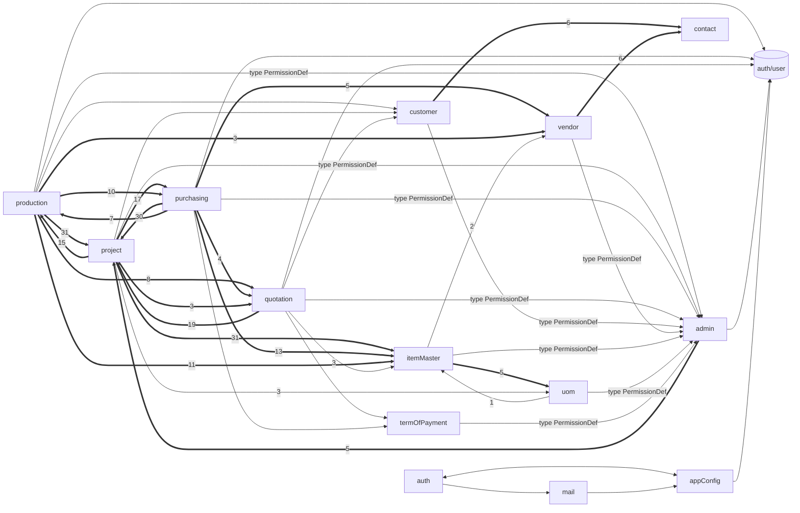
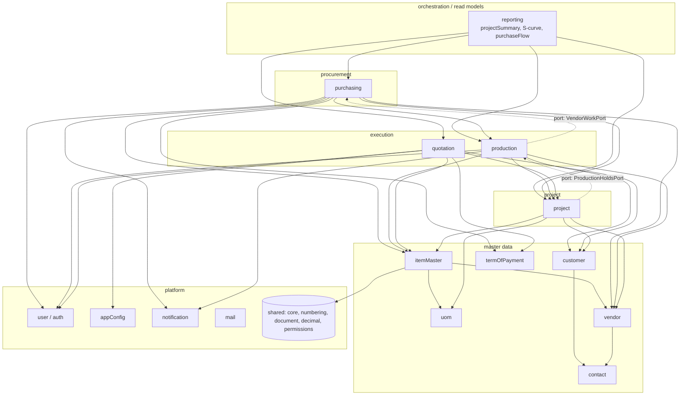

# Backend tidiness & module-boundary audit — 2026-11-24

Scope: `backend/src` (299 files). Audit only: nothing was moved, renamed or edited.
Evidence came from `madge --json` (full import graph), knip, jscpd and targeted greps. Each import edge was assigned to the module that **owns** its source and target files; the ownership table is in §0.2.

> **Progress (2026-11-24).** Steps 0–8, 16 and the 17–18 guardrail are done; see [ADR-0001](../docs/adr/0001-module-boundaries.md).
>
> **Steps 17–18 (guardrail):** `npm run check:boundaries` runs dependency-cruiser (`.dependency-cruiser.cjs`, swc parser because TypeScript 7.0 has no compiler API). It is in error mode, with the existing leaks baselined in `.dependency-cruiser-known-violations.json` (7 entries, all type-only; `check:boundaries:baseline` runs in shrink-only mode, so it can only remove fixed entries). **The baseline is the live backlog:**
> - Deep imports into other modules (steps 9–15): **none left** (V-01 resolved). 67 were switched to `index.ts`: platform 22, project 23, itemMaster 19, uom 3. Test files are excluded from the check; `quotation.planner.test.ts` still imports `project/projectRab.planner` directly.
> - Runtime foreign model imports: **none left.** Production → purchasing, the uom reads, the production / quotation reads of project files and admin shrinkDb (V-05) are resolved: see below.
> - 7 type-only foreign model imports, reported as info
>
> **Known guardrail gaps** (until step 19): modules may still import another module's flat `dto/*.dto.ts` / `validation/*.ts` files (e.g. `production/vendorWork.ts` → `dto/projectRab.dto`), and test files are not checked.
>
> The rules also cover cycles, shared → module imports, upward layer imports and identity models (all clean). `dto/` and `validation/` files count as their owning module until step 19. Fixed while adding it: `computeEffective` moved from `admin/roles/role.service` to `core/permissions/registry` (V-10 leftover), and three uom deep imports now go through `modules/uom`. `UserModel` reads in admin are allowed as platform (ADR rule 9); appConfig no longer reads it.
>
> **Step 16 (ports):**
> - **No cycles anywhere**: madge finds no file-level cycle, and there is no module-level cycle (Tarjan SCC is empty).
> - **Layer order changed:** purchasing now sits *below* production. The `reporting` module was dropped in favour of ports, so URLs and RBAC categories are unchanged.
> - **Resolved:**
>   - V-07: purchasing reads SPKs through its port
>   - V-09: charges moved to shared code
>   - V-30: the DTO cycle is gone
> - **Graph:** 39 module edges, 185 imports. Foreign model call sites: 74 → 63.
> - **Still open:**
>   - ~~production → purchasing models~~ **resolved:** `purchasing.public.ts` owns "live SPP" (`LIVE_REQUEST_STATUSES`, now also used by `purchaseRab.service`) and "live realization", and offers `countLivePurchasesForSpks`, `listSpkPurchaseOrders` (SPK lines only; `newest` / `firstApproved` sort), `realizedQtyByPoLine` (to us / to vendor), `getPurchaseOrderNumbers`, `getPurchaseOrderLines`. The 15 call sites in production use them; 10 unit tests. Live check: every SPK detail on the dev DB matched the old queries (3 SPKs; no subcon dispatches in dev data, so those paths are covered by tests only).
>   - ~~Uom 13~~ **resolved:** `uom.public.ts` owns "active UoM" and offers `listActiveUoms({ sorted })`, `getUomsByIds` and the `UOM_DEFAULT_DECIMALS` / `UOM_MAX_DECIMALS` constants; itemMaster (bulk template / import, item UoM rows, `getItemUomRows`), project (`projectRabUomPlan`) and `validation/itemMaster` use them. 4 unit tests. Live check: all 95 dev items' UoM rows and the template's UoM sheet matched the old queries. Item UoM save and bulk import (writes) were not exercised live.
>   - Project file models: **resolved for production and quotation.** `project.public.ts` adds `listCurrentItemFiles`, `listShopDrawingBoqs` (returns `ShopDrawingBoqSnapshot`, the stored shape the planners read, like `ProjectRabSnapshot`), `getShopDrawingFileNames` / `getProductionFileNames`; `fileVersionsById` is now exported. `quotation.public.ts` adds `getWonQuotationRef` (production readiness). 7 unit tests. Live: readiness / progress / SPK detail unchanged; quotation seed lines for all 6 dev projects matched. 
>   - ~~Admin shrinkDb (V-05)~~ **resolved:** `project/projectFileMaintenance.ts` (exported from `project/index.ts`) owns the 5 project models' maintenance: `assertProjectsExist`, `listNonCurrentFileVersionIds`, `shrinkFileVersion` (audited soft-delete with `deletedReason: "shrink_db"`, then purge the blob if no live row references it), `purgeShrinkDeletedBlobs`, `listUnreferencedProjectBlobIds`, `purgeUnreferencedProjectBlobs`, `listFileScopesMissingCurrent`. Project now owns the `project` GridFS bucket; admin keeps the job loop, progress, `ShrinkRun` and audit cleanup. 12 unit tests. Live (read-only): non-current version ids per kind (with and without an excluded project), unreferenced blobs, scopes missing current and the unknown-project error all matched the old queries on dev. Live documents shrink on dev (in-process through `shrinkDbService`, since `tsx --watch` restarted the dev server mid-run on the first, HTTP attempt; that run was marked `interrupted` and changed nothing): 8 non-current shop drawing versions soft-deleted by the user with reason `shrink_db` and 8 audit rows, 3 unreferenced blobs purged (bucket 40 → 37), the 1 shared blob kept, 18 current versions untouched, orphan report unchanged; smoke sizes unchanged afterwards. One intended difference: `deletedAt` is stamped per version instead of once per kind.
>   - Admin / appConfig on `UserModel` 11: allowed as platform (ADR rule 9).
>
> Notes from steps 0–8:
> - Resolved:
>   - V-06: production owns "live SPK" / "valid report"
>   - V-10: RBAC lookups moved to `core/permissions/resolve.service`, and they return DTOs
>   - V-11, V-12, V-13: vendor / customer / term of payment contracts with a single "active" rule
>   - V-14: assignable users and the display name live in `auth`
>   - V-15: itemMaster contract
>   - V-18 (`utils/numbering.ts`)
>   - V-19: `utils/document/`, with the letterhead now in `appConfig`
>   - V-20 (`core/permissions/types.ts`)
>   - V-21: user lookups moved to the `auth` contract
>   - V-28 (`utils/ids.ts`)
>   - V-29 (`utils/time.ts`)
> - Mostly resolved:
>   - V-02, V-03, V-04: project refs, shop-drawing items, RAB and the won / released writes go through the project contract. Project *file* models (documents, SD documents, production files, BOQ) are still read by production and quotation.
> - Still open:
>   - V-01: deep imports to module files remain (steps 9–15)
>   - ~~V-05: admin shrinkDb~~ resolved
>   - ~~V-07, V-08: production ↔ purchasing models~~ resolved (step 16 + purchasing contract)
>   - Uom model reads (13)
> - Foreign model call sites: 160 → 74. Imports that reach another module's model: 108 → 61.
> - Module graph: 44 edges, 211 imports.
> - (After step 8) cycles were project / purchasing / production / quotation and auth / appConfig / mail, plus 2 barrel cycles. Step 16 removed all of them.
>
> The rest of this document is the original audit snapshot.

> **Facts vs opinions.** Lines marked **[fact]** are measured. Lines marked **[opinion]** are judgment calls.

> ⚠️ **The target layout conflicts with the project's own rules.** `CLAUDE.md` / `.cursor/rules/backend.md` currently require:
> - flat `models/`, `dto/` and `validation/` folders
> - *"no separate Repository layer"*
> - *"Do not invent a new architecture"*
>
> The target in this audit puts models, validation and DTOs inside each module and adds `index.ts` contracts. That is a deliberate architecture change, so if you adopt it, update `CLAUDE.md` in the same PR that starts the migration. Otherwise every agent session will keep "fixing" files back to the flat layout.

---

## 1. Executive summary

- **[fact] The domain is one big dependency knot.** `project`, `purchasing`, `production` and `quotation` all import each other's **private files and models**. There are 4 mutual pairs: project↔purchasing, project↔production, production↔purchasing, project↔quotation. At module level, 10 modules form one strongly-connected cycle.
- **[fact] 160 call sites query a model that belongs to another module.** The main ones: `UserModel` 25×, `VendorRepo` 18×, `ProjectRepo` 15×, `UomRepo` 12×, `ProjectShopDrawingItemRepo` 12×, `PurchaseOrderRepo` 11×, `ProductionOrderRepo` 10×. No module has an `index.ts` contract today. Nothing uses `.populate()`.
- **[fact] Business rules are copied across modules instead of being owned.** These rules each appear in several modules:
  - "live production order" = `status: { $ne: "cancelled" }`: 13 places in 3 modules
  - "valid production report" = `isVoided: false`: 11 places in 2 modules
  - "active vendor": 3 modules, and they don't agree on the rule
  - "assignable user" = `isBlocked: { $ne: true }`: 2 modules
  - an RBAC "users with permission" query that lives inside `purchaseOrder.service.ts`
- **[fact] Several "shared" helpers live inside a domain module and are the real reason for many edges:**
  - document numbering (`project/projectNumber.ts`)
  - letterhead / PDF document helpers (`quotation/quotation.logo.ts`, `quotation.document.ts`)
  - decimal and UoM math (`itemMaster/itemUomConvert.ts`, imported by 20+ files in 5 modules)
  - the permission-def type (`admin/admin.permissions.ts`, imported by every `*.permissions.ts`)
- **[opinion] Layering inside each module is mostly good.** Controllers are thin and services never touch `req`/`res`. The main tidiness debt is in naming and folder shape:
  - 21 helper files in modules have no role suffix
  - `AppConfig.*` and `appconfig.model.ts` use mixed casing
  - three one-file "contact" modules
  - 49 files over 300 lines

### Scores per module (1 = poor, 5 = clean)

| Module | Boundaries | Layering | Naming | Duplication |
| --- | --- | --- | --- | --- |
| project | 1 | 3 | 3 | 3 |
| purchasing | 1 | 3 | 2 | 2 |
| production | 1 | 4 | 3 | 3 |
| quotation | 2 | 4 | 4 | 3 |
| itemMaster | 3 | 4 | 3 | 4 |
| uom | 3 | 4 | 4 | 4 |
| auth / user | 2 | 4 | 3 | 4 |
| admin (users, roles, audit, shrinkDb) | 2 | 4 | 4 | 4 |
| customer | 4 | 5 | 5 | 1 |
| vendor | 2 | 5 | 5 | 1 |
| termOfPayment | 3 | 5 | 5 | 4 |
| appConfig | 4 | 4 | 2 | 4 |
| notification | 5 | 5 | 5 | 5 |
| contact (email / phone / ownerContact) | 3 | 4 | 2 | 4 |
| mail, otp, media | 4 | 4 | 3 | 5 |

"Boundaries" scores how well the module's own boundary holds. That covers both other modules reaching into it and it reaching into others.

---

## Phase 0 — Map of what exists

### 0.1 Folders under `src/`

| Folder | Class | Notes |
| --- | --- | --- |
| `modules/<19>` | domain modules (some are tiny) | folder-by-feature for routes, controllers, services and planners |
| `models/` (43) | **domain, but stored by layer** | each model belongs to one module (see §0.2) |
| `dto/` (29) | **domain, stored by layer** | `httpResponse.ts` is the only truly shared file |
| `validation/` (30) | **domain, stored by layer** | `asRecord.ts`, `parseParam.ts`, `query.ts` and `uploadFile.ts` are shared |
| `core/` | shared | `env`, `logger`, `database`, `gridfs`, `audit/`, `permissions/` |
| `middleware/` | shared | `authenticate`, `requireUser`, `rateLimit` |
| `utils/` | **unclear** | `email.ts` and `jwt.ts` are generic. `shared.ts` is a grab-bag that holds date helpers, regex, duplicate-key detection **and `UserModel` queries** |
| `scripts/` | unclear / dead | one unused one-off migration (`resetItemLevelSpks.ts`) |
| `index.ts` | composition root | it also runs bootstrap, seeding and listen (there's no separate `app.ts`) |

### 0.2 Modules, their files, and what they own

| Module | Files (role) | Owns models |
| --- | --- | --- |
| **project** (37) | route, controller (845 lines), permissions, services: `project`, `projectCalendar`, `projectDocument`, `projectLooseFile`, `projectRab`, `projectRabChange`, `projectRabExport`, `projectSchedule`, `projectShopDrawing`, `projectShopDrawingBoq`, `projectSummary`, `versionedProjectFile`. Planners: `projectRab`, `projectRabChange`, `projectRabExport`, `projectSCurve`, `projectSummary`. Helpers without a suffix: `fileIngest`, `projectCurrentFiles`, `projectNumber`, `projectRabLock`, `projectRabUomPlan`, `projectShared`, `projectShopDrawingPurge`, `projectShopDrawingSpec` | project, projectCalendarEvent, projectDocument, projectLooseFile, projectProductionFile, projectRab, projectRabChange, projectSchedule, projectShopDrawingBoq, projectShopDrawingDocument, projectShopDrawingItem |
| **purchasing** (34) | 1 route, **6 controllers** (`purchasing`, `purchaseOrder`, `purchasePayment`, `purchaseRab`, `purchaseRealization`, `vendorInvoice`), permissions, 8 services, 6 planners, 2 `*.pdf.ts` **plus** `purchasingPdf.ts`. Helpers: `paymentNotify`, `purchasingNotify`, `purchaseOrderLines`, `realizationLines`, `vendorMoney` | purchaseCharge, purchaseOrder, purchaseOrderQuotation, purchasePayment, purchaseRab, purchaseRealization, purchaseRequest, vendorInvoice |
| **production** (16) | route, controller, permissions, services: `production`, `productionHandover`, `productionProcess`, `materialDispatch`. `materialDispatch.queries.ts`, a planner, 3 pdf files. Helpers: `productionNotify`, `stageFlow`, `vendorWork` | productionOrder, productionReport, productionHandover, materialDispatch |
| **quotation** (16) | 2 routes (private + `publicQuotation`), 2 controllers, service, planner, `access`, `document`, `export`, `logo`, `pdf`, `xlsx` | projectQuotation |
| **itemMaster** (15) | route, controller, permissions, services: `itemMaster`, `itemBulk`, `itemCategory`, `itemTarif`, `itemUom`. Helpers: `folderPath`, `itemMeta`, `itemUomConvert` | item, itemCategory, itemTarif, itemUom, folder |
| **uom** (8) | route, controller, permissions, service, seed, `uomFormula` | uom |
| **customer** / **vendor** (4 each) | route, controller, permissions, service | customer / vendor |
| **termOfPayment** (4) | route, controller, permissions, service | termOfPayment |
| **auth** (3) | route, controller, service | user (shared with admin), otp (through the `otp` module) |
| **admin** (+ `audit/`, `roles/`, `permissions/`, `shrinkDb/`) | route, controller, service, and sub-features each with a controller and service | role, permission, shrinkRun; it also manages users |
| **appConfig** (4) | `AppConfig.route` / `.controller` / `.service` (PascalCase) | appconfig |
| **notification** (3) | route, controller, service | notification |
| **email**, **phone**, **ownerContact** | 1–2 services each, **no routes** | email, phone (contact sub-documents for customer and vendor) |
| **mail**, **otp**, **media** | 1 file each (Brevo mailer, OTP, GridFS public route) | otp |
| *shared* | `models/seqCounter.model.ts` (counters for 4 modules) | seqCounter |

### 0.3 Current module dependency graph

The edge label is the number of import statements. Thick arrows are edges into another module's **private** files or models.



**Cycles [fact, from Tarjan SCC over the module graph]:**

- `{project, purchasing, production, quotation, itemMaster, uom, vendor, customer, termOfPayment, admin}` form **one** strongly-connected component.
  - The edges from every module into `admin` are only the `PermissionDef` type.
  - `admin → project` is shrinkDb.
  - Remove those two and the real knot is project ↔ purchasing ↔ production ↔ quotation, plus itemMaster ↔ uom.
- `{auth, appConfig, mail}`: `auth → appConfig` (register toggles), `appConfig → UserModel` (first-admin check), `mail → appConfig` (sender name / logo).
- File-level: 1 cycle, `dto/projectRab.dto.ts ↔ dto/purchasing.dto.ts` (type-only).

### 0.4 Conventions actually in use [fact]

- **Hybrid layout.** Folder-by-feature for HTTP and services (`modules/<x>/`), folder-by-layer for `models/`, `dto/` and `validation/`. This is the layout `CLAUDE.md` documents.
- **File names.** `<feature>.<role>.ts` in camelCase with roles route / controller / service / planner / permissions / pdf / xlsx / seed / queries. 21 module files have **no role suffix**. `appConfig` uses PascalCase (`AppConfig.service.ts`) while its model is lowercase (`appconfig.model.ts`).
- **Model exports.** Audited models are exported as `XxxRepo` (`auditedModel` wrapper, read via `XxxRepo.model`) and plain ones as `XxxModel`. Both styles coexist.
- **Routes.** All files are `*.route.ts`; none use `*.routes.ts`. The RBAC category is **derived from the route filename** and **persisted** on Permission documents (`core/permissions/routing.ts:25-28`, `sync.ts:150`). Renaming a route file therefore renames a category.
- **"Planners."** Pure functions in `*.planner.ts` hold the domain math and are where the unit tests live. This is good, and the target should keep it.
- **Validation.** Hand-written `parse*` functions, no zod/joi.

---

## Phase 1 — Automated evidence

| Check | Result |
| --- | --- |
| `madge --circular` | 1 file-level cycle (`dto/projectRab.dto.ts:7` ↔ `dto/purchasing.dto.ts:1`, type-only) |
| Module-level cycles (madge JSON + ownership + SCC) | 2 SCCs: a **10-module** domain knot and `auth/appConfig/mail`. **7 mutual pairs** |
| Cross-module edges | 52 module→module edges and 275 import statements. 108 of those statements target another module's **model** |
| Foreign-model **query** call sites | **160** (list in `§3`, grouped by model) |
| Deep imports into another module's non-index files | **all of them**: no module has an `index.ts` |
| `shared → modules` | `utils/shared.ts:67-100` → `UserModel`; `middleware/authenticate.ts` → `UserModel`; `core/permissions/resolve.service.ts` → `UserModel`, `RoleModel`; `core/permissions/sync.ts` → `PermissionModel`, `RoleModel`, `modules/admin/roles/role.service.ts`; `core/permissions/registry.ts` → 11 `*.permissions.ts` |
| `.populate()` | **0** |
| knip unused exports | 92 exports and 102 exported types. By folder: project 48, models 36, purchasing 21, quotation 18, validation 15, production 15 |
| jscpd cross-module clones | customer↔vendor 14 · production↔purchasing 25 (mostly PDF) · production↔quotation 8 (PDF) · purchasing↔quotation 6 (PDF) · project↔purchasing 3 · 6 others with 1 each |

---

## 2. Target module dependency graph

**[opinion]** Strict layering: lower layers never import higher ones. Where a lower module genuinely needs data from a higher one (it happens), the lower module declares a small **port** (an interface) and the composition root (`app.ts`) plugs in the higher module's public function. This is the only way to satisfy rule 7 without merging modules.



Reverse needs that become **ports** instead of imports:

1. `project → production`: RAB change and shop-drawing checks need "live SPKs / held lines" (`projectRabChange.service.ts:100`, `projectShopDrawing.service.ts:200`, `projectSchedule.service.ts:197`).
2. `production → purchasing`: vendor work and notifications need POs and approvers (`vendorWork.ts:90-368`, `productionNotify.ts:74`).
3. `project → purchasing`: `projectSummary.service.ts:149` belongs in `reporting`. The `purchaseCharge` schema and planner reused by RAB (`projectRab.model.ts`, `projectRab.planner.ts`) belong in `shared/charges` because they're shared money logic, not purchasing internals.
4. `project → quotation`: `projectSummary.*` moves to `reporting`. `project.service.ts` reading `ProjectQuotationRepo` becomes `quotation.getLatestForProjects(ids)` called from a higher layer, or a port.

---

## 3. Violations table

Effort: S < 1h, M = half a day, L = 1+ day. **[fact]** unless the Type column says *(opinion)*.

| ID | Module | Type | File:line | Fix | Effort |
| --- | --- | --- | --- | --- | --- |
| V-01 | all | deep import | no `modules/*/index.ts` exists; all 275 cross-module imports are deep | add `index.ts` per module (step 6a) | M |
| V-02 | project ← production | foreign model | `production.service.ts` imports `ProjectRepo`, `ProjectRabRepo`, `ProjectShopDrawingItemRepo`, `-Boq`, `-Document`, `ProjectProductionFileRepo`; `stageFlow.ts:88` (`ProjectRabRepo`); `productionHandover.service.ts`, `productionProcess.service.ts` (`ProjectRepo`); `models/productionOrder.model.ts` imports `projectRab.model` | project public API: `getRabForProject`, `getShopDrawingItems`, `getProjectRef` | L |
| V-03 | project ← purchasing | foreign model | `purchaseOrder.service.ts:277,1249`, `purchasing.service.ts:194` (`ProjectRabRepo`); `purchaseOrder.service.ts`, `purchasing.service.ts` (`ProjectRepo`, `ProjectShopDrawingItemRepo`) | same project public API | L |
| V-04 | project ← quotation | foreign model | `quotation.service.ts:889` (`ProjectRabRepo`), plus `ProjectRepo`, `ProjectShopDrawing*Repo`; `models/projectQuotation.model.ts` imports `project.model` | project public API | M |
| V-05 | project ← admin | foreign model | `admin/shrinkDb/shrinkDb.service.ts` imports 5 project file models | project public `listStoredFileRefs()` / `purgeStoredFiles()`. *(Discuss: shrinkDb is maintenance by nature, so a documented exception is also acceptable)* | M |
| V-06 | production ← project | foreign model + leaked rule | `projectShopDrawing.service.ts:200-204`, `projectRabChange.service.ts:100-101`, `projectSchedule.service.ts:197`, `projectSummary.service.ts:128` query `ProductionOrderRepo` / `ProductionReportRepo` with `status: {$ne:"cancelled"}` / `isVoided:false` | production public `countLiveOrdersForItem`, `getLiveOrdersForProject`, `getValidReports`; reach them from project through a port | M |
| V-07 | production ← purchasing | foreign model | `purchaseFlow.service.ts:157`, `purchaseOrder.service.ts:433`, `purchasing.service.ts:131,296,341,802` (`ProductionOrderRepo`) | production public `getOrdersByIds`, `getOrdersForProject` | M |
| V-08 | purchasing ← production | foreign model | `vendorWork.ts:90,173,262,284,350`, `productionNotify.ts:74`, `production.service.ts:422,518`, `productionProcess.service.ts:185`, `materialDispatch.queries.ts:153` (`PurchaseOrderRepo`); `production.service.ts`, `productionProcess.service.ts` (`PurchaseRequestRepo`); `vendorWork.ts` (`PurchaseRealizationRepo`) | purchasing public `getVendorWorkOrders(orderIds)` and similar, behind `VendorWorkPort`. *(Opinion: `vendorWork.ts` may belong in purchasing outright)* | L |
| V-09 | purchasing ← project | foreign model | `projectSummary.service.ts:149` (`PurchaseOrderRepo`, `PurchaseRealizationRepo`); 8 project files import `models/purchaseCharge.model.ts`; 4 import `purchasing/purchaseRealization.planner.ts` | move the charge schema and charge math to `shared/charges`; move the summary to `reporting` | M |
| V-10 | purchasing | deep import (private service) | `production/productionNotify.ts:7` and `purchasing/paymentNotify.ts:8` import `usersWithPermission` from `purchaseOrder.service.ts:151` | move it to the user/permissions public API (V-14) | S |
| V-11 | vendor | foreign model + leaked rule | `VendorRepo` queried 18× in itemMaster, production, project, purchasing. "Active vendor" is implemented 3 ways: `itemMaster.service.ts:92-110` (`isActive === false` → error), `purchaseOrder.service.ts:508` (`{isActive:{$ne:false}}`), `purchaseOrder.service.ts:1153-1159` | vendor public `getVendorsByIds`, `assertVendorsActive`, `listActiveVendors` | M |
| V-12 | customer | foreign model | `project.service.ts:105,117,174`, `quotation.service.ts:978`, `production.service.ts:1445` | customer public `getCustomerRef(s)` | S |
| V-13 | termOfPayment | foreign model + leaked rule | `purchaseOrder.service.ts:517,637,1155`, `quotation.service.ts:340-344` (`top.isActive === false`) | public `getTerm(id, {activeOnly})`, `listActiveTerms()` | S |
| V-14 | user (auth) | foreign model + leaked rule | `UserModel` queried 25× outside auth/admin. The "assignable user" rule `isBlocked` appears at `production.service.ts:215-219,739`, `purchaseRealization.service.ts:87,110`, `purchaseOrder.service.ts:157,165`. RBAC queries sit at `purchaseOrder.service.ts:151-169` (`RoleModel`) | user public `getUserRefs`, `assertAssignableUser`, `listAssignableUsers`, `usersWithPermission`, `userHasPermission` | M |
| V-15 | itemMaster | foreign model | `ItemRepo` at `projectRabExport.service.ts:71,108` and `projectShopDrawingSpec.ts:130`; `FolderRepo` at `projectRabExport.service.ts:80` (loads the **whole** folder collection to build paths); `ItemUomRepo` at `projectRabUomPlan.ts:80`, `projectShopDrawingBoq.service.ts:563`, `purchasing.service.ts:207`; `models/projectRab.model.ts` imports `itemUom.model` | itemMaster public `getItemsByIds`, `getItemFolderPaths`, `getItemUomFactors` | M |
| V-16 | itemMaster | deep import (de-facto API) | `itemMeta.ts` (imported by 4 modules) and `itemMaster.service.ts`, `itemUom.service.ts`, `itemTarif.service.ts` (imported by project and purchasing) | re-export them through `itemMaster/index.ts`; don't rewrite them | S |
| V-17 | uom ↔ itemMaster | cycle | `uom/uom.service.ts` → `itemMaster/itemUomConvert.ts`; itemMaster → `models/uom.model.ts` (4 files), `uom/uomFormula.ts` | move the generic decimal helpers from `itemUomConvert.ts` (`parsePositiveDecimal`, `parseQtyDecimal`, `formatDecimal`) to `shared/decimal.ts`; itemMaster uses uom's public API | S |
| V-18 | project → shared (misplaced) | misplaced shared code | `project/projectNumber.ts` (document numbering and seq allocator) used by 9 production and purchasing files | move to `shared/numbering.ts` | S |
| V-19 | quotation → shared (misplaced) | misplaced shared code | `quotation/quotation.logo.ts` and `quotation.document.ts` imported by 7 production and 4 purchasing files | move to `shared/document/` (letterhead, `formatRp`, `formatLongDate`, logo fit). This also sets up the PDF dedupe in the first audit | S |
| V-20 | admin → shared (misplaced) | misplaced shared code | `PermissionDef` type in `admin/admin.permissions.ts:1`, imported by 10 `*.permissions.ts` | move the type to `core/permissions/types.ts` | S |
| V-21 | shared → modules | shared imports a module | `utils/shared.ts:67-100` (`userEmailsById`, `userRefsById` query `UserModel`) | move to the user module's public API | S |
| V-22 | shared → modules | shared imports a module *(opinion: acceptable)* | `core/permissions/registry.ts` imports 11 `*.permissions.ts`; `sync.ts` imports `admin/roles/role.service.ts` | treat the registry as composition-root code (move it next to `app.ts`), or accept it as a documented exception | S |
| V-23 | purchasing | wrong layer | `purchasing.controller.ts:160-176`: controller runs a `PurchaseRequestRepo.exists()` ownership query and RBAC branching | move to `purchaseFlow.service.ts` as `assertCanViewFlow(user, kind, id)` | S |
| V-24 | admin | wrong layer | `admin/permissions/permission.service.ts:1` imports Express `Application` | pass the scan result in instead of the app | S |
| V-25 | contact | foreign model *(in dto/validation)* | `dto/customer.dto.ts`, `validation/customer.ts`, `dto/vendor.dto.ts`, `validation/vendor.ts` import `email.model` / `phone.model` | contact public types `EmailDto` / `PhoneDto` | S |
| V-26 | customer ≡ vendor | duplication | `customer.service.ts` and `vendor.service.ts` are identical after the name swap; same for `validation/customer.ts:17-137` ≈ `vendor.ts` | shared `counterparty` building blocks *(opinion: keep the two modules, share the internals)* | M |
| V-27 | production / purchasing / quotation | duplication | the 6 PDF builders (see `AUDIT.md` D-2) | `shared/document/pdf` primitives | L |
| V-28 | production / purchasing | duplication | `productionNotify.ts:19` ≡ `paymentNotify.ts:25` (`uniqueIds` except helper) | `shared/ids.ts` | S |
| V-29 | shared | duplication | `project/projectNumber.ts:20-37` (`JakartaYmd`, `jakartaYmd`) wraps `utils/shared.ts:31-56` (`JakartaYmdParts`); `quotation.document.ts:79` hard-codes `"Asia/Jakarta"` again | one `shared/time.ts` | S |
| V-30 | dto | cycle | `dto/projectRab.dto.ts:7` ↔ `dto/purchasing.dto.ts:1` | goes away with V-09 (charge DTOs → shared) | S |
| V-31 | appConfig | naming | `AppConfig.route.ts`, `AppConfig.controller.ts`, `AppConfig.service.ts`, `AppConfig.service.test.ts`; `models/appconfig.model.ts` | rename to `appConfig.*`. ⚠️ the RBAC category changes from `AppConfig` to `appConfig` (stored) | S |
| V-32 | several | naming | 21 module files have no role suffix (list in §0.2); `purchasingPdf.ts` sits next to `purchasingDoc.pdf.ts` and `purchaseOrder.pdf.ts` | adopt `.helpers.ts` / `.queries.ts` / `.notify.ts` / `.pdf.ts` suffixes | S |
| V-33 | auth / otp / dto | naming | `models/otp.model.ts:3` `Otpinterface`; `dto/register.dto.ts:1` `registerInDto`; `XxxRepo` vs `XxxModel` export styles | `OtpInterface`, `RegisterInDto`; document the Repo/Model distinction (audited vs plain) | S |
| V-34 | contact / mail / otp / media | folder shape *(opinion)* | `modules/email` (2 files), `phone` (1), `ownerContact` (1), `mail` (1), `otp` (1), `media` (1 route) | merge into `contact/` (email, phone, ownerContact), `auth/` (otp), `shared/mail`, and `shared/files` (media + gridfs) | S |
| V-35 | scripts | dead code | `scripts/resetItemLevelSpks.ts` (knip: unused file) | delete, or wire it as an npm script | S |
| V-36 | all | API bloat | 92 unused exports and 102 unused exported types (knip) | when writing each `index.ts`, export only what callers use; un-export the rest | M |
| V-37 | project / purchasing / production / quotation | oversized | 49 files > 300 lines; worst: `purchaseOrder.service.ts` 1,676, `production.service.ts` 1,563, `projectRabChange.service.ts` 1,235, `quotation.service.ts` 1,177 | split along the public-API seams as they appear; don't split up front *(opinion)* | L |

---

## 4. Per-module cards

Signatures are proposals. **[opinion]** These are minimal APIs, built only from what callers use today.

### project
- **Owns:** 11 collections (§0.2) and `/project/*`.
- **Public API today (deep imports):**
  - `projectNumber.ts`: production ×3, purchasing ×6
  - `projectRab.planner.ts`: production, purchasing, quotation
  - `projectRabExport.planner.ts`: production, purchasing, quotation
  - `projectShared.ts`: production, purchasing
  - `projectRab.service.ts` and `projectRabChange.service.ts`: production, quotation
  - `projectRabUomPlan.ts`, `projectShopDrawingSpec.ts`, `projectCurrentFiles.ts`, `versionedProjectFile.service.ts`
  - models: `ProjectRepo` (15 foreign call sites), `ProjectShopDrawingItemRepo` (12), `ProjectShopDrawingDocumentRepo` (9), `ProjectRabRepo` (6), `ProjectDocumentRepo` (6)
- **Violations:**
  - **inbound:** V-02, V-03, V-04, V-05
  - **outbound:** V-06 (production models), V-09 (purchasing models and planner), V-15 (item models), `ProjectQuotationRepo` (`project.service.ts`, `projectSummary.service.ts`), `CustomerRepo` (`project.service.ts:105,117,174`), `VendorRepo` (`projectRabExport.service.ts:121`), `UomRepo` (`projectRabUomPlan.ts`)
- **Leaked rules:** "live SPK" (`projectShopDrawing.service.ts:202`, `projectRabChange.service.ts:101`) and "valid report" (`projectSchedule.service.ts`, `projectSummary.service.ts`, `projectRabChange.service.ts`) re-implement production's rules.
- **Wrong layer:** none found. The controller is large (845 lines) but thin per handler.
- **Returns documents across the boundary:** callers read `.lean()` docs straight from the models, so there's no DTO contract at all.
- **Proposed public API:**
  ```ts
  getProjectRef(id: string): Promise<ProjectRefDto | null>                 // id, number, name, customerId
  getProjectRefs(ids: string[]): Promise<Map<string, ProjectRefDto>>
  assertProjectExists(id: string): Promise<void>
  getRabForProject(projectId: string): Promise<RabDto | null>              // status + lines + charges, locked-aware
  getShopDrawingItems(ids: string[]): Promise<ShopDrawingItemDto[]>
  getShopDrawingSpec(itemIds: string[]): Promise<Map<string, ShopDrawingSpecDto>>
  applyProcessChange(input: ProcessChangeInput): Promise<RabChangeRefDto>  // used by production
  // pure re-exports: rabLineKey, rab planner types used by others
  export type { ProjectRefDto, RabDto, RabLineDto, ShopDrawingItemDto }
  export { projectRouter }
  // port it declares:
  interface ProductionHoldsPort { liveOrdersForProject(id): Promise<HeldOrderDto[]>; countLiveForItem(itemId): Promise<number>; validReports(projectId): Promise<ReportDto[]> }
  ```

### purchasing
- **Owns:** 8 collections and `/purchasing/*`.
- **Public API today:**
  - `purchaseOrder.service.ts` (`usersWithPermission`) → production
  - `purchasingNotify.ts` → production
  - `purchaseRealization.planner.ts` → project ×4
  - models: `PurchaseOrderRepo` 11×, `PurchaseRequestRepo` 2×, `PurchaseRealizationRepo` 3×, `purchaseCharge.model` imported by 8 project files
- **Violations:**
  - **inbound:** V-08, V-09
  - **outbound:** V-03, V-07, V-11, V-13, V-14, `RoleModel` (`purchaseOrder.service.ts:152`), deep imports into `production.service.ts` and `vendorWork.ts`
- **Leaked rules:** purchasing re-implements "active vendor", "active term", "assignable user" and "user has permission".
- **Wrong layer:** V-23 (controller DB query).
- **Naming:** the 6 controllers share one route file (fine). `purchasingPdf.ts` and `purchasingDoc.pdf.ts` overlap. `paymentNotify.ts` and `purchasingNotify.ts` overlap.
- **Proposed public API:**
  ```ts
  getOrdersForProductionOrders(ids: string[]): Promise<VendorWorkOrderDto[]>   // replaces vendorWork/production PO reads
  getProjectSpend(projectId: string): Promise<ProjectSpendDto>                  // for reporting
  getRequestsForProductionOrder(id: string): Promise<PurchaseRequestRefDto[]>
  export type { VendorWorkOrderDto, ProjectSpendDto }
  export { purchasingRouter }
  ```

### production
- **Owns:** 4 collections and `/production/*`.
- **Public API today:**
  - `production.planner.ts` → project ×4
  - `stageFlow.ts` → project ×3
  - `production.service.ts` → project, purchasing
  - `vendorWork.ts` → purchasing
  - `validation/production.ts` → `validation/purchasing.ts`
  - models: `ProductionOrderRepo` 10×, `ProductionReportRepo` 3×
- **Violations:**
  - **inbound:** V-06, V-07
  - **outbound:** V-02, V-08, V-11, V-12, V-14, `ProjectQuotationRepo` (`production.service.ts`)
- **Leaked rules out:** production owns "live SPK" and "valid report" but never exports them, so project and purchasing copy them (13 + 11 places).
- **Proposed public API:**
  ```ts
  getLiveOrdersForProject(projectId: string): Promise<ProductionOrderRefDto[]>  // status != cancelled
  countLiveOrdersForShopDrawingItem(itemId: string): Promise<number>
  getValidReports(projectId: string): Promise<ProductionReportDto[]>            // isVoided = false
  getOrdersByIds(ids: string[]): Promise<ProductionOrderRefDto[]>
  // pure: stage/progress math used by project S-curve (from production.planner.ts)
  export { productionRouter }
  // port it declares:
  interface VendorWorkPort { ordersFor(productionOrderIds: string[]): Promise<VendorWorkOrderDto[]> }
  ```

### quotation
- **Owns:** `projectQuotation`, `/quotation/*`, `/public/quotation/*`.
- **Public API today:** `quotation.logo.ts` and `quotation.document.ts` → production and purchasing (really shared, V-19); `quotation.planner.ts` → `projectSummary.planner.ts`; `ProjectQuotationRepo` → project and production.
- **Outbound:** V-04, `CustomerRepo`, `TermOfPaymentRepo`, `UserModel`, `AppConfigService`.
- **Proposed public API:**
  ```ts
  getLatestQuotationForProject(projectId: string): Promise<QuotationRefDto | null>
  getLatestForProjects(ids: string[]): Promise<Map<string, QuotationRefDto>>   // for reporting / project list
  export { quotationRouter, publicQuotationRouter }
  ```

### itemMaster
- **Owns:** item, itemCategory, itemTarif, itemUom, folder (+ item seq counter); `/items`, `/folders`, etc. (mounted at `/`).
- **Public API today:**
  - `itemUomConvert.ts`: 20+ files in project, production, purchasing, quotation and uom
  - `itemMeta.ts`: 4 modules
  - `itemMaster.service.ts`, `itemUom.service.ts`, `itemTarif.service.ts`: project, purchasing
  - `folderPath.ts`: project
  - `validation/itemMaster.ts`: project
- **Inbound violations:** V-15, V-16.
- **Outbound violations:** `VendorRepo` (`itemMaster.service.ts:95`, `itemBulk.service.ts:167,264`), uom models (V-17).
- **Leaked rules:** none found leaking *out of* itemMaster. Note that `loadItemMeta` (`itemMeta.ts:17-45`) returns items **regardless of `isActive`**. That's correct for historical documents, but it means there is **no** "active items" public function yet. Callers that need active-only data must ask for it explicitly.
- **Proposed public API:**
  ```ts
  getItemMeta(ids: string[]): Promise<{ items: Map<string, ItemMetaDto>; uoms: Map<string, UomMetaDto> }>  // = loadItemMeta, includes inactive (history)
  getActiveItemsByIds(ids: string[]): Promise<ItemDto[]>        // isActive + existing category/folder
  getLabourItemIds(ids: string[]): Promise<Set<string>>
  getItemFolderPaths(itemIds: string[]): Promise<Map<string, string[]>>
  getItemUomFactors(itemIds: string[]): Promise<Map<string, ItemUomFactorDto[]>>
  getTarifs(itemIds: string[]): Promise<Map<string, ItemTarifDto[]>>
  convertItemQty, convertByFactors                              // pure re-exports
  export { itemMasterRouter }
  ```

### uom
- **Owns:** uom; `/uom`.
- **Inbound:** `UomRepo` used 12× by itemMaster and project.
- **Outbound:** the cycle with itemMaster (V-17).
- **Proposed API:** `getUomsByIds(ids)`, `listActiveUoms()`, `uomFormula` (pure).

### vendor / customer
- **Owns:** vendor / customer; `/vendor`, `/customer`.
- **Inbound:** V-11 / V-12.
- **Outbound:** contact models (V-25).
- **Duplication:** V-26.
- **Proposed API:**
  ```ts
  getVendorsByIds(ids: string[]): Promise<Map<string, VendorRefDto>>   // name, address, npwp, isActive
  assertVendorsActive(ids: string[]): Promise<void>                    // single definition of "active vendor"
  listActiveVendors(): Promise<VendorRefDto[]>
  getCustomerRef(id: string): Promise<CustomerRefDto | null>
  getCustomerRefs(ids: string[]): Promise<Map<string, CustomerRefDto>>
  ```

### termOfPayment
- **Inbound:** V-13.
- **Proposed API:** `getTerm(id, opts?: { activeOnly?: boolean })`, `listActiveTerms()`.

### user (today split across `auth`, `admin`, `utils/shared.ts`, `core/permissions`)
- **Owns:** user, otp.
- **Inbound:** `UserModel` used 25× in 5 modules + 3 shared files (V-14, V-21).
- **Proposed API:**
  ```ts
  getUserRefs(ids: string[]): Promise<Map<string, UserRefDto>>   // was utils/shared userRefsById / userEmailsById
  assertAssignableUser(id: string): Promise<UserRefDto>          // exists + not blocked
  listAssignableUsers(): Promise<UserRefDto[]>
  usersWithPermission(key: string): Promise<UserRefDto[]>        // was purchaseOrder.service.ts:151
  userHasPermission(id: string, key: string): Promise<boolean>   // was purchaseOrder.service.ts:164
  findUserForAuth(id: string): Promise<AuthUser | null>          // for middleware/authenticate
  ```

### admin
- **Owns:** role, permission, shrinkRun; `/admin/*`.
- **Outbound:** V-05 (shrinkDb → project models), `UserModel`.
- **Inbound:** every module imports `admin.permissions.ts` for a **type** (V-20); purchasing reads `RoleModel`.

### appConfig, notification, contact, mail, otp, media
- **appConfig:** the `auth ↔ appConfig` cycle comes from `AppConfig.service.ts:50` reading `UserModel` for the first-admin check. It should call `user.hasSuperAdmin()`. Naming is covered by V-31.
- **notification:** clean. Its only caller is `purchasingNotify.ts`, through `notification.service.ts`, which becomes its `index.ts`.
- **contact (email / phone / ownerContact):** used only by customer and vendor. Merge the three folders.
- **mail / otp / media:** single-file modules. They are platform code, not domains (V-34).

---

## 5. Proposed final folder tree

**[opinion]** Keep `*.route.ts` (singular, as used today) rather than renaming to `.routes.ts`. Renaming a route file changes the **stored** RBAC category (§0.4) for no gain. Keep the `*.planner.ts` pure-logic files, because they are the test surface.

```
src/
  app.ts                      ← createApp + mountRouter calls, port wiring, permission registry
  server.ts                   ← bootstrap: db, audit init, scan/sync/seed, listen, shutdown
  config/env.ts
  shared/
    http/        httpResponse.ts, parseParam.ts, query.ts, asRecord.ts, uploadFile.ts
    db/          database.ts, gridfs.ts, audit/ (auditedModel, context), seqCounter.model.ts
    permissions/ requirePermission.ts, routing.ts, scan.ts, sync.ts, resolve.ts, types.ts (PermissionDef)
    middleware/  requireUser.ts, rateLimit.ts
    logger.ts  jwt.ts  email.ts (normalize)  time.ts (Jakarta)  ids.ts  decimal.ts
    numbering.ts              ← was project/projectNumber.ts
    charges/                  ← purchaseCharge schema + charge math shared by RAB & purchasing
    document/                 ← letterhead, logo, formatRp/longDate, pdf primitives
    mail.ts                   ← was modules/mail
    files/                    ← media route + gridfs helpers
  modules/
    user/        index.ts user.model.ts otp.model.ts auth.route.ts auth.controller.ts auth.service.ts otp.service.ts user.public.ts user.validation.ts user.types.ts
    admin/       index.ts admin.route.ts … roles/ audit/ permissions/ shrinkDb/  role.model.ts permission.model.ts shrinkRun.model.ts
    appConfig/   index.ts appConfig.route.ts appConfig.controller.ts appConfig.service.ts appConfig.model.ts
    notification/
    contact/     index.ts email.model.ts phone.model.ts email.service.ts phone.service.ts ownerContact.service.ts
    uom/
    itemMaster/  index.ts itemMaster.public.ts item.model.ts itemCategory.model.ts itemTarif.model.ts itemUom.model.ts folder.model.ts …
    customer/  vendor/  termOfPayment/
    project/     index.ts project.public.ts project.ports.ts  + its 11 models, dto, validation
    quotation/
    production/  index.ts production.public.ts production.ports.ts …
    purchasing/
    reporting/   index.ts projectSummary.*, projectSCurve.planner.ts, purchaseFlow.service.ts
```

Each module folder holds: `index.ts`, `<m>.route.ts`, `<m>.controller.ts`, `<m>.service.ts`, `<m>.public.ts`, `<m>.planner.ts`, `<m>.model.ts`, `<m>.dto.ts` (the public DTO types are re-exported from `index.ts`) and `<m>.validation.ts`.

---

## 6. Migration plan (each step is one commit and keeps `tsc` + tests green)

**Step 0: decide and record.**
1. Update `CLAUDE.md` / `.cursor/rules/backend.md` to describe the module-boundary rules.
2. Add an ADR in `docs/adr/` for the module contract. This stops future agents re-flattening the layout.

**a. Add `index.ts` public APIs. No behavior change.**

1. Extract the misplaced shared code (pure moves; callers get a one-line import change):
   - `PermissionDef` → `core/permissions/types.ts` (V-20)
   - `projectNumber.ts` → `shared/numbering.ts` (V-18)
   - `quotation.logo.ts` / `quotation.document.ts` → `shared/document/` (V-19)
   - decimal helpers → `shared/decimal.ts` (V-17)
   - Jakarta time → `shared/time.ts` (V-29)
   - `uniqueIds` → `shared/ids.ts` (V-28)

   This alone removes the itemMaster↔uom cycle and most of the `→ admin` / `→ quotation` edges.
2. For each module, add `index.ts` that **re-exports the functions callers already use**: `loadItemMeta`, `itemUomService`, `production.planner` exports, and so on. No new logic.
3. Add `user.public.ts` by moving `userRefsById` / `userEmailsById` (`utils/shared.ts`) and `usersWithPermission` / `userHasPermission` (`purchaseOrder.service.ts:151-169`) (V-10, V-21).

**b. Move duplicated business rules into their owner's public functions.**

4. production: `getLiveOrdersForProject`, `countLiveOrdersForShopDrawingItem`, `getValidReports` (V-06).
5. vendor, termOfPayment and customer: `getXByIds`, `assertVendorsActive`, `getTerm({activeOnly})`. Make "active" mean one thing (V-11, V-12, V-13).
6. user: `assertAssignableUser`, `listAssignableUsers` (V-14).
7. itemMaster: `getItemFolderPaths`, `getItemUomFactors`, `getActiveItemsByIds` (V-15).
8. project: `getProjectRef(s)`, `getRabForProject`, `getShopDrawingItems` (V-02 to V-04).

**c. Switch callers to the public API, one module per commit.** Suggested order, smallest blast radius first:

9. customer, vendor, termOfPayment, uom
10. itemMaster
11. user
12. quotation
13. production
14. purchasing
15. project

**d. Make internals private and fix the layer leaks.**

16. Add the ports: `ProductionHoldsPort` in project and `VendorWorkPort` in production, wired in `app.ts`. Move `projectSummary` / S-curve / `purchaseFlow` into a `reporting` module. Move the charge schema to `shared/charges` (V-09). After this the module graph is acyclic.
17. Fix the controller query (V-23) and the Express dependency in `permission.service.ts` (V-24).
18. Turn on the guardrail (§7) in **warn** mode, fix the leftovers, then switch it to **error**.

**e. Renames and folder moves last.**

19. Move `models/*`, `dto/*` and `validation/*` into their modules. Each move is mechanical: `git mv` plus an import rewrite.
20. Make the naming fixes:
    - `appConfig` casing (V-31: tell admins the stored category changes)
    - role suffixes (V-32)
    - `OtpInterface` / `RegisterInDto` (V-33)
    - merge contact / mail / otp / media (V-34)
21. Split `index.ts` into `app.ts` + `server.ts` and delete the dead script (V-35). Prune the unused exports (V-36).

Steps 1–3 and 9 are pure refactors; they're cheap and low risk. Steps 4–8 and 16 change where rules live, so each needs a test of the new public function written first. The existing planner tests already show the pattern.

---

## 7. Guardrails

> **Implemented (steps 17–18).** See `.dependency-cruiser.cjs`: the sketch below was extended with the step-16 layer order, `*.ports.ts` as a public entry, per-owner model rules (dto / validation count as module code) and a baseline instead of a warn phase. The sketch is kept as the original proposal.

**dependency-cruiser** (`.dependency-cruiser.cjs`). It fits better than ESLint here because it understands folder-level rules and cycles:

```js
module.exports = {
  forbidden: [
    { name: "no-circular", severity: "error", from: {}, to: { circular: true } },
    { name: "module-only-via-index", severity: "error",
      from: { path: "^src/modules/([^/]+)/" },
      to: { path: "^src/modules/([^/]+)/", pathNot: ["^src/modules/$1/", "^src/modules/[^/]+/index\\.ts$"] } },
    { name: "shared-not-into-modules", severity: "error",
      from: { path: "^src/(shared|config)/" }, to: { path: "^src/modules/" } },
    { name: "models-private", severity: "error",
      from: { path: "^src/modules/([^/]+)/" },
      to: { path: "^src/modules/([^/]+)/.*\\.model\\.ts$", pathNot: "^src/modules/$1/" } },
    { name: "layering", severity: "error",   // lower layers never import higher ones
      from: { path: "^src/modules/(itemMaster|uom|vendor|customer|termOfPayment|contact)/" },
      to: { path: "^src/modules/(project|quotation|production|purchasing|reporting)/" } },
  ],
  options: { tsConfig: { fileName: "tsconfig.json" }, doNotFollow: { path: "node_modules" } },
};
```

- **Until step 19:** models stay in `src/models/`, so add a temporary rule that only files in `src/modules/<owner>/` may import `src/models/<owner-model>`. The ownership table in §0.2 is the input.
- **ESLint fallback (lighter):** `no-restricted-imports` with `patterns: ["**/modules/*/!(index)"]` in every module, plus `import/no-cycle`.
- **CI step:** `npx depcruise src --config .dependency-cruiser.cjs` in the same workflow as `tsc` / `eslint` / `test` (see `AUDIT.md` §6). Run it in warn mode first and publish the report as an artifact; switch to `error` after step 18.
- **Agent rule:** add the boundary rules to `CLAUDE.md` so the "MANDATORY graphify" exploration also respects `index.ts` contracts.
